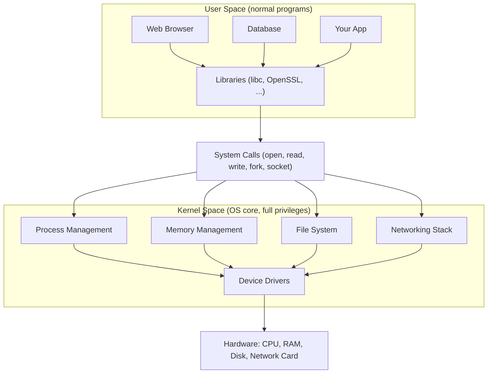
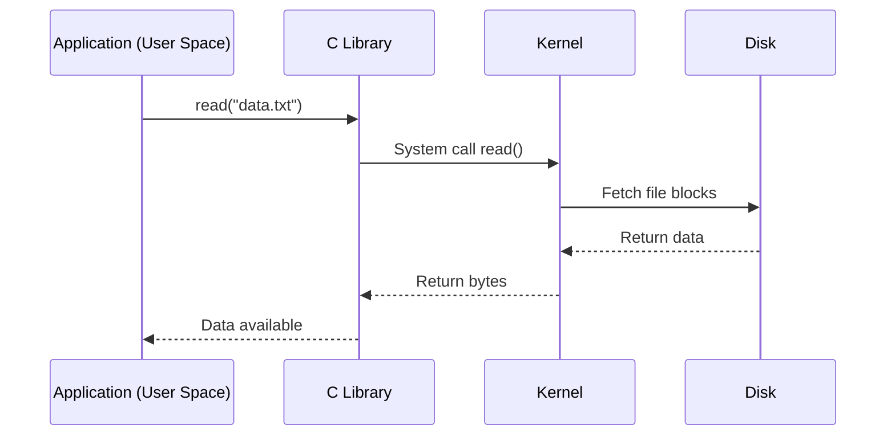
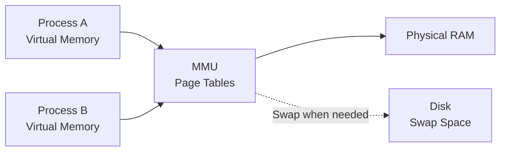
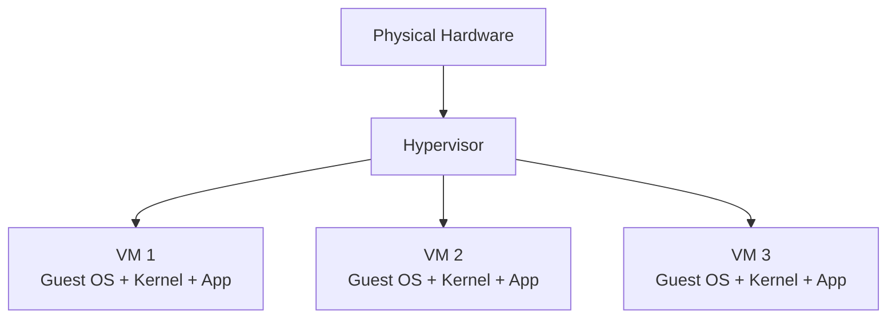

# Prerequisite – How an Operating System Works

> Concept only. You need this to understand why Docker is lightweight.

## 1.1 What is an Operating System (OS)?

An Operating System (OS) is software that sits between **applications** and **hardware**.

It manages and shares computer resources such as:

- CPU
- RAM
- Disk
- Network

For example, when you run Chrome, VS Code, and MySQL simultaneously, the OS manages how these programs use the available resources.

**Key idea:** The OS acts as a resource manager between applications and hardware.

## 1.2 OS Layers

An Operating System has two main areas:

1. User Space
2. Kernel Space



| Part | Meaning |
|---|---|
| **Kernel** | The core of the OS. Controls hardware, memory, processes, files, and networks. |
| **User Space** | Where normal applications run. They have limited privileges and must request kernel services. |
| **System Call** | A mechanism applications use to request services from the kernel. |
| **Drivers** | Kernel components that communicate with specific hardware. |

### Key idea for Docker

Containers **share the host kernel**.

A container is not a separate OS. It is a group of processes running with an isolated view of system resources.

This is one of the main reasons containers are lightweight.

## 1.3 How a Program Asks the Kernel for Help

Applications cannot directly control hardware in normal circumstances.

They request services from the kernel using **System Calls**.

Example: An application wants to read `data.txt`.



The process:

1. Application requests a file read.
2. Library invokes the appropriate system call.
3. Kernel accesses the filesystem.
4. Kernel obtains the requested data.
5. Data is returned to the application.

Example in Node.js:

```javascript
const fs = require("fs");

const data = fs.readFileSync("data.txt", "utf8");

console.log(data);
```

**Key idea:** Applications request operating system services through system calls.

## 1.4 Memory Management and Process Isolation

Each process normally has its own private virtual address space.

The kernel and CPU's Memory Management Unit (MMU) map virtual memory addresses to physical RAM using page tables.



### What is Virtual Memory?

Virtual memory makes each process behave as if it has its own private memory space.

For example:

- Process A: Chrome
- Process B: MySQL
- Process C: Node.js API

Each process has its own virtual address space.

### What is Swap?

When physical RAM becomes insufficient, the OS may move some memory pages to disk swap space.

Disk is slower than RAM, so excessive swapping can reduce performance.

### Security Purpose: Process Isolation

If an attacker compromises Process A, they normally cannot directly read or modify Process B's private memory.

The kernel and hardware enforce memory protection.

However, kernel vulnerabilities or excessive privileges may allow an attacker to bypass normal protections.

**Key idea:** Process isolation helps prevent one compromised process from automatically accessing other processes.

## 1.5 File System and Filesystem Isolation

Linux organizes files and directories in a tree structure starting from `/`.

```text
/
├── bin      Essential commands
├── etc      Configuration files
├── home     User files
├── usr      Programs and libraries
├── var      Logs and changing data
└── proc     Live process and kernel information
```

### How Docker Uses Filesystems

Each container gets its own filesystem view, usually built from an image.

Docker images consist of read-only layers.

When a container starts, Docker adds a writable layer on top.

Multiple containers can share the same read-only image layers while having separate writable layers.

Volumes can be used for persistent data.

### Security Purpose: Filesystem Isolation

If Container A gets hacked, the attacker normally cannot access files inside Container B or the host filesystem.

However, this depends on permissions and configuration.

For example:

- Mounting sensitive host directories can expose host files.
- Incorrect file permissions can expose data.
- Sharing directories between containers can create additional access paths.

**Key idea:** Filesystem isolation limits which files and directories a container can access.

## 1.6 Virtualization (Virtual Machines)

A hypervisor allows one physical machine to run multiple Virtual Machines (VMs).

Each VM has its own:

- Guest OS
- Kernel
- Applications
- Virtual memory
- Filesystem



Examples of hypervisors:

- VMware
- KVM
- Hyper-V
- VirtualBox

### Security Purpose: VM Isolation

Each VM runs its own operating system and kernel.

If VM 1 gets hacked:

- The attacker may gain control of VM 1's Guest OS.
- The attacker normally cannot directly access VM 2.
- The attacker normally cannot directly control the physical host OS.
- The attacker would generally need to exploit the hypervisor or another weakness to escape.

This is called **VM Escape**.

VMs generally provide a stronger isolation boundary than ordinary containers because they have separate guest kernels.

## 1.7 Container vs VM: Security Comparison

| Feature | Container | VM |
|---|---|---|
| Own OS Kernel | No | Yes |
| Shares Host Kernel | Yes | No |
| Isolation Type | OS-level | Hardware virtualization |
| Compromised application | May compromise its container | May compromise its guest OS |
| Host protection | Depends on kernel and configuration | Depends on hypervisor and configuration |
| Escape attack | Container Escape | VM Escape |
| Resource overhead | Lower | Higher |

### Docker's Main Advantage

Containers share the host kernel instead of running a complete guest operating system.

This makes them lightweight and fast to start.

---
