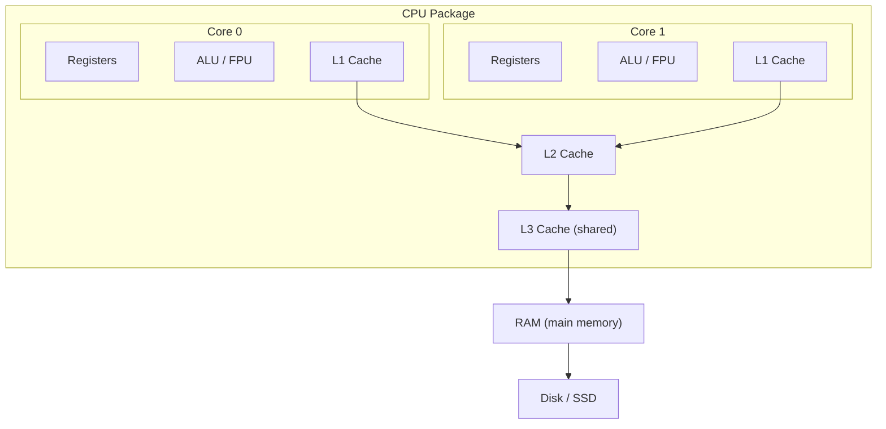
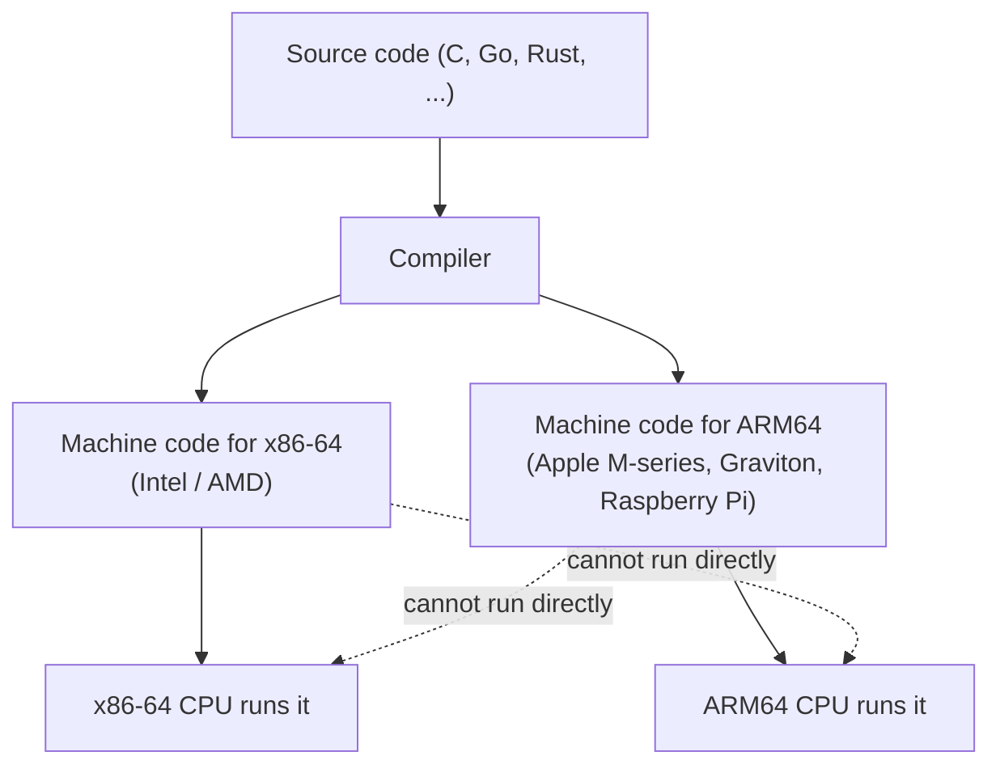
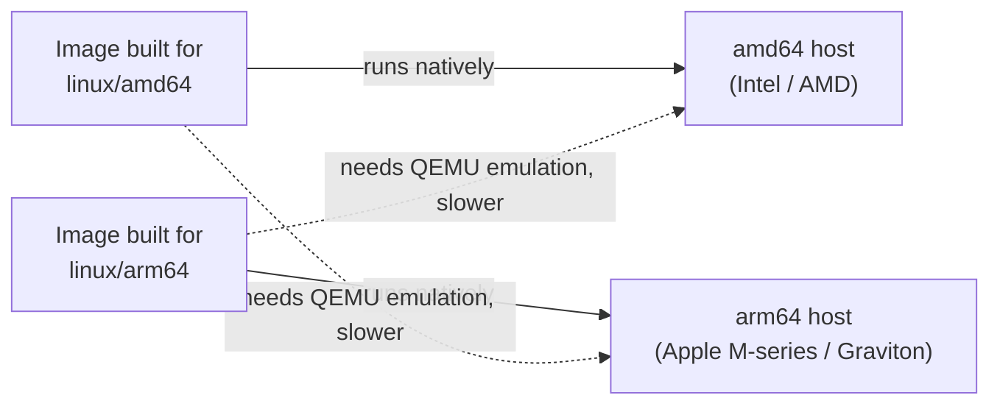

## 2. Prerequisite: CPU Architecture
 
> Concept only. This explains why a Docker image built for one CPU may not run on another.
 
### 2.1 What does a CPU do?
 
The CPU repeats a loop forever: **Fetch -> Decode -> Execute -> Store**.
 

 
### 2.2 Inside a Modern CPU
 

 
| Term | Meaning |
|---|---|
| **Core** | An independent processing unit. More cores = more tasks in parallel. |
| **Thread** | A path of execution. One core may run 2 threads (hyper-threading / SMT). |
| **Registers** | Tiny, fastest storage inside the core. |
| **Cache (L1, L2, L3)** | Small, fast memory that stores frequently used data. |
| **ALU** | Arithmetic Logic Unit, performs calculations. |
 
Speed order (fast to slow): **Registers -> L1 -> L2 -> L3 -> RAM -> SSD -> Network**.
 
### 2.3 Instruction Set Architecture (ISA)
 
The **ISA** is the "language" a CPU understands. A program is compiled into machine code for **one specific ISA**.
 

 
### 2.4 Common Architectures
 
| Architecture | Other names | Type | Found in |
|---|---|---|---|
| **x86-64** | `amd64`, `x64` | CISC | Intel / AMD PCs, laptops, most servers |
| **ARM64** | `arm64`, `aarch64` | RISC | Apple Silicon (M1-M4), AWS Graviton, Raspberry Pi 4/5, phones |
| **ARMv7** | `arm/v7`, `armhf` | RISC (32-bit) | Older Raspberry Pi, IoT |
| **RISC-V** | `riscv64` | RISC (open) | Emerging boards and chips |
 
- **CISC**: many complex instructions (x86).
- **RISC**: fewer, simpler instructions; usually power-efficient (ARM).
### 2.5 Why This Matters for Docker
 
A container runs machine code **directly on the host CPU** (no translation). So:
 

 
Check your CPU architecture:
 
```bash
uname -m
# x86_64  -> amd64
# aarch64 -> arm64
```
 