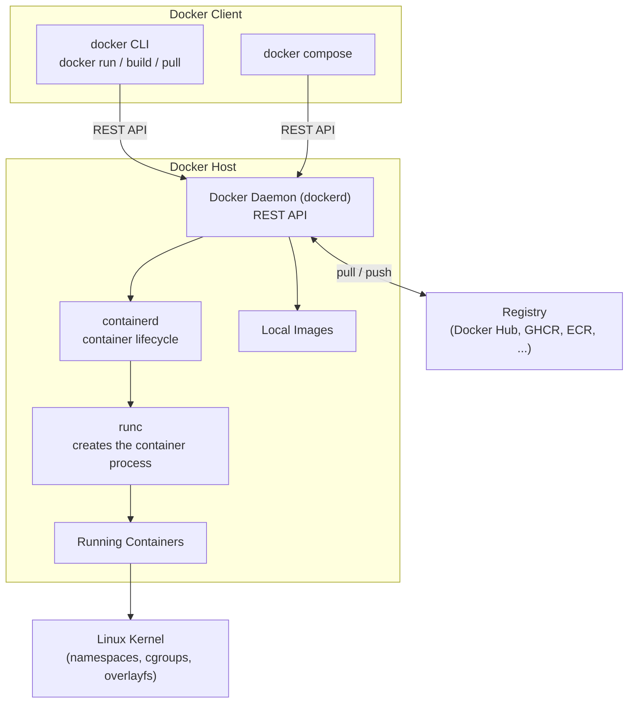
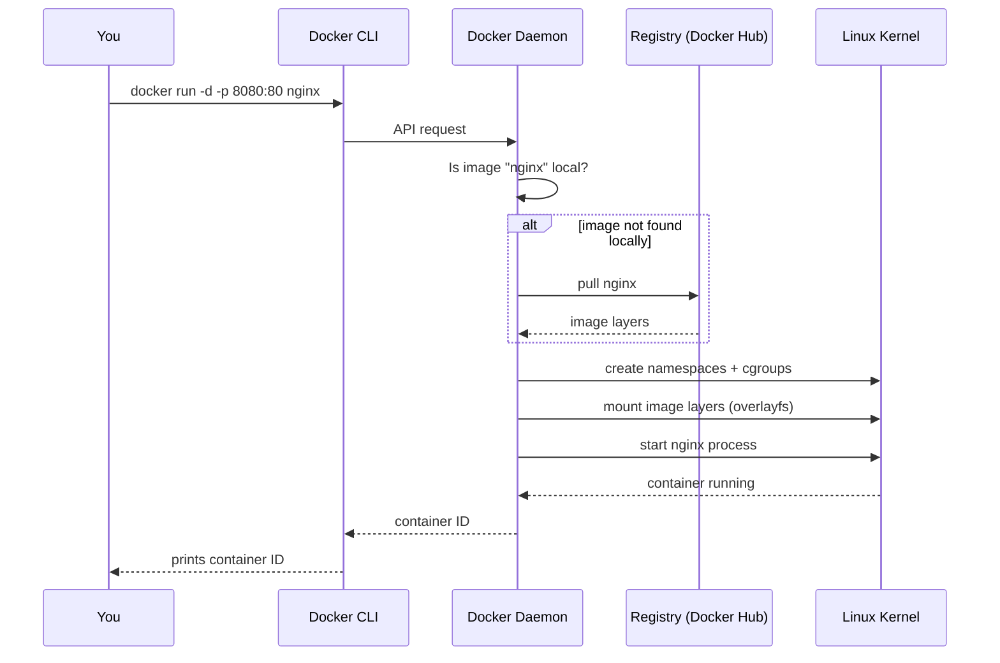
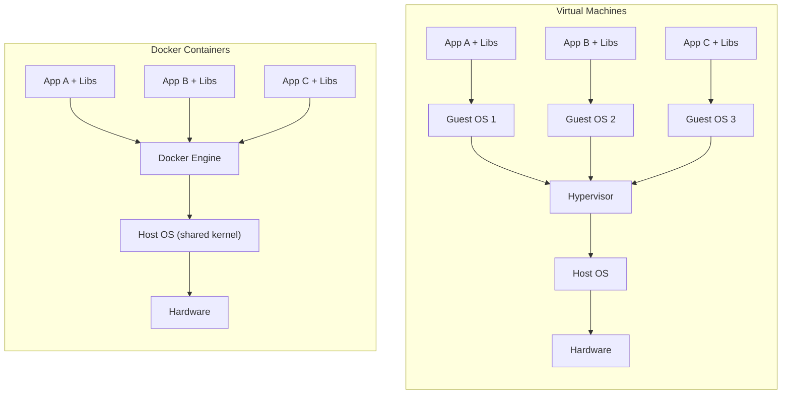
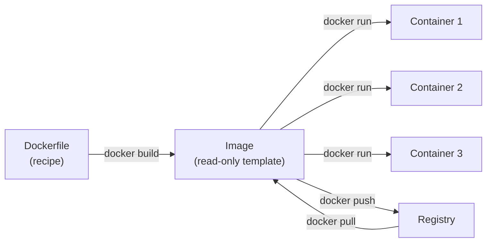
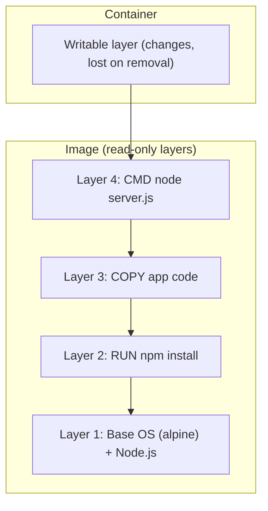
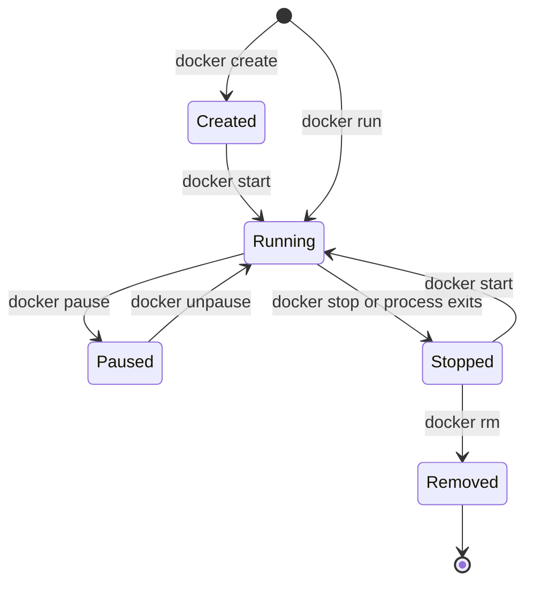

## 3. Docker Introduction: How Docker Works
 
### 3.1 What is Docker?
 
**Docker** is an open-source platform to **package an application with everything it needs** (code, runtime, libraries, settings) into a **container**, so it runs the same way everywhere.
 
> Problem: "It works on my machine, but not on the server!"
 
| Benefit | Meaning |
|---|---|
| Consistent | Same behavior in dev, test, production |
| Lightweight | Shares the host kernel; starts in seconds |
| Portable | Build once, run anywhere Docker runs |
| Isolated | Apps do not interfere with each other |
| Scalable | Start many copies easily |
 
### 3.2 Docker Architecture (Docker Engine)
 

 
| Component | Role |
|---|---|
| **Docker Client** (`docker`) | The command-line tool you type into |
| **Docker Daemon** (`dockerd`) | Background service that builds images and manages containers, networks, volumes |
| **containerd** | Manages the container lifecycle (start, stop, images, snapshots) |
| **runc** | Low-level tool that actually creates the isolated process |
| **Registry** | Storage for images (Docker Hub is the default) |
 
**Docker Engine** = Docker daemon + CLI + API (+ containerd and runc underneath).
**Docker Desktop** = a GUI app for Windows / macOS / Linux that bundles Engine, Compose and more. On Windows and macOS it runs a small hidden Linux VM, because containers need a Linux kernel.
 
### 3.3 What Happens When You Run `docker run`?
 

 
### 3.4 Docker vs Virtual Machine
 

 
| Feature | Docker Container | Virtual Machine |
|---|---|---|
| Virtualizes | OS level (shares host kernel) | Hardware level (full guest OS) |
| Size | MBs | GBs |
| Startup | Seconds | Minutes |
| Performance | Near native | Some overhead |
| Isolation | Process level (good) | Hardware level (strongest) |
| Density | Hundreds per host | Dozens per host |
| Different OS kernel | No (same kernel as host) | Yes (any guest OS) |
| Best for | Microservices, CI/CD, fast scaling | Different OS, strict security separation |
 
### 3.5 Images and Containers
 

 
- **Image** = blueprint (read-only, made of layers).
- **Container** = a running instance of an image (adds a thin writable layer).
**Image layers:**
 

 
Layers are cached and shared: faster builds, less disk space.
 
**Container lifecycle:**
 

 
> Containers are **ephemeral**. Data in the writable layer is lost when the container is removed. Use **volumes** for data you want to keep.
 
### 3.6 Installation
 
**Ubuntu / Debian (Docker Engine):**
 
```bash
# 1. Prerequisites
sudo apt-get update
sudo apt-get install -y ca-certificates curl
 
# 2. Add Docker's official GPG key
sudo install -m 0755 -d /etc/apt/keyrings
sudo curl -fsSL https://download.docker.com/linux/ubuntu/gpg -o /etc/apt/keyrings/docker.asc
sudo chmod a+r /etc/apt/keyrings/docker.asc
 
# 3. Add the repository
echo \
  "deb [arch=$(dpkg --print-architecture) signed-by=/etc/apt/keyrings/docker.asc] \
  https://download.docker.com/linux/ubuntu \
  $(. /etc/os-release && echo "${UBUNTU_CODENAME:-$VERSION_CODENAME}") stable" | \
  sudo tee /etc/apt/sources.list.d/docker.list > /dev/null
 
# 4. Install
sudo apt-get update
sudo apt-get install -y docker-ce docker-ce-cli containerd.io docker-buildx-plugin docker-compose-plugin
 
# 5. (Optional) run docker without sudo
sudo usermod -aG docker $USER
newgrp docker
 
# 6. Start on boot
sudo systemctl enable --now docker
```
 
**Windows:**
 
1. Enable virtualization in BIOS. Install WSL 2: `wsl --install`
2. Download **Docker Desktop for Windows** from <https://www.docker.com/products/docker-desktop/>
3. Run the installer (choose "Use WSL 2"), restart, open Docker Desktop.

**macOS:**
 
1. Download **Docker Desktop for Mac** (Apple Silicon or Intel version).
2. Drag it to Applications and open it. Or: `brew install --cask docker`
**Verify:**
 
```bash
docker --version
docker compose version
docker run hello-world
```
 
**Choosing a CPU platform (see section 2):**
 
```bash
docker run --platform linux/amd64 nginx      # force an architecture
docker buildx build --platform linux/amd64,linux/arm64 -t myuser/app:1.0 --push .   # multi-arch build
```
 