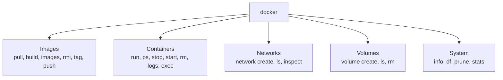
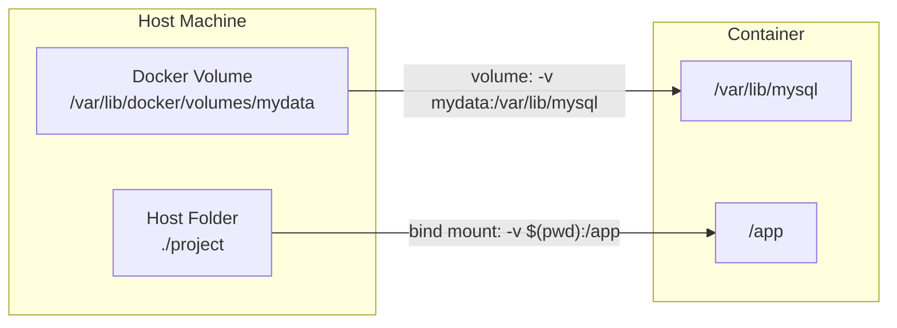

## 4. Docker Commands
 
### 4.1 Command Map
 

 
### 4.2 Container Commands
 
| Command | What it does |
|---|---|
| `docker run <image>` | Create and start a container |
| `docker run -d <image>` | Run in background (detached) |
| `docker run -it <image> bash` | Interactive terminal |
| `docker run --rm <image>` | Auto-remove after exit |
| `docker ps` | List running containers |
| `docker ps -a` | List all containers (including stopped) |
| `docker stop <name>` | Gracefully stop |
| `docker start <name>` | Start a stopped container |
| `docker restart <name>` | Restart |
| `docker rm <name>` | Remove a stopped container |
| `docker rm -f <name>` | Force remove (even if running) |
| `docker logs <name>` | View logs |
| `docker logs -f <name>` | Follow logs live |
| `docker exec -it <name> bash` | Open a shell in a running container |
| `docker inspect <name>` | Detailed info (JSON) |
| `docker stats` | Live CPU / memory usage |
| `docker top <name>` | Processes inside a container |
| `docker cp file.txt <name>:/path/` | Copy files host <-> container |
 
### 4.3 Image Commands
 
| Command | What it does |
|---|---|
| `docker images` | List local images |
| `docker pull <image>:<tag>` | Download an image |
| `docker build -t name:tag .` | Build an image from a Dockerfile |
| `docker tag <src> <dest>` | Add another name/tag |
| `docker push <image>` | Upload to a registry |
| `docker rmi <image>` | Remove an image |
| `docker history <image>` | Show image layers |
| `docker save -o app.tar <image>` | Export image to a file |
| `docker load -i app.tar` | Import image from a file |
 
### 4.4 Useful `docker run` Options
 
| Option | Meaning |
|---|---|
| `-d` | Run in background |
| `-it` | Interactive + terminal |
| `--name web` | Name the container |
| `-p 8080:80` | Map host port 8080 to container port 80 |
| `-v mydata:/data` | Mount a volume or folder |
| `-e KEY=value` | Set an environment variable |
| `--env-file .env` | Load variables from a file |
| `--network mynet` | Connect to a network |
| `--restart unless-stopped` | Restart policy |
| `--memory 512m --cpus 1` | Resource limits |
| `--rm` | Remove container when it exits |
 
### 4.5 Volumes (Persistent Data)
 

 
| Type | Example | Best for |
|---|---|---|
| **Volume** | `-v mydata:/data` | Databases, persistent data (recommended) |
| **Bind mount** | `-v $(pwd):/app` | Development, live code reload |
| **tmpfs** | `--tmpfs /tmp` | Temporary data in memory |
 
```bash
docker volume create mydata
docker volume ls
docker volume rm mydata
```
 
### 4.6 Cleanup Commands
 
```bash
docker system df            # show disk usage
docker container prune      # remove stopped containers
docker image prune -a       # remove unused images
docker volume prune         # remove unused volumes
docker system prune -a      # remove everything unused (careful!)
```
 
### 4.7 Real Examples
 
```bash
# Nginx web server
docker run -d --name web -p 8080:80 nginx
 
# MySQL with persistent data
docker run -d --name mydb \
  -e MYSQL_ROOT_PASSWORD=secret \
  -e MYSQL_DATABASE=appdb \
  -v mysql_data:/var/lib/mysql \
  -p 3306:3306 \
  mysql:8
 
# Redis cache
docker run -d --name cache -p 6379:6379 redis:7
 
# One-time command
docker run --rm python:3.12 python -c "print('Hello Docker')"
```
