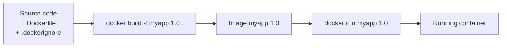
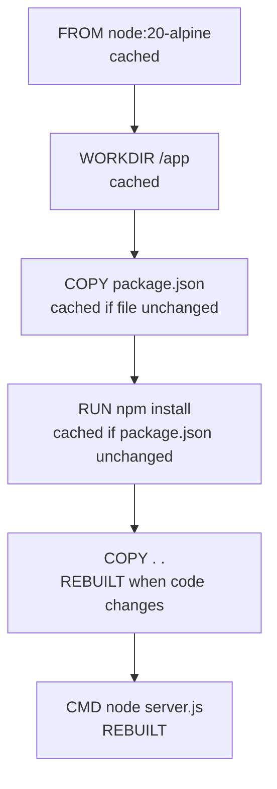
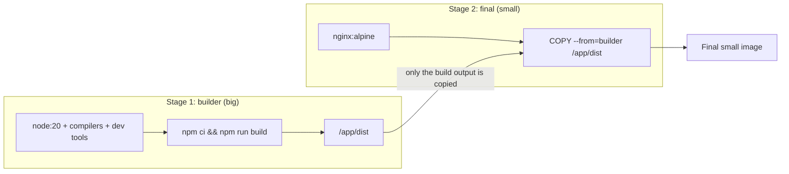

## 5. Dockerfile
 
A **Dockerfile** is a text file of step-by-step instructions to build an image.
 
### 5.1 Build Flow
 

 
### 5.2 Common Instructions
 
| Instruction | Purpose |
|---|---|
| `FROM` | Base image to start from |
| `WORKDIR` | Set the working directory |
| `COPY` / `ADD` | Copy files into the image |
| `RUN` | Run a command at **build** time (install packages) |
| `ENV` | Set environment variables |
| `ARG` | Build-time variable |
| `EXPOSE` | Document the port the app uses |
| `USER` | Run as a non-root user |
| `VOLUME` | Declare a mount point |
| `CMD` | Default command at **run** time (can be overridden) |
| `ENTRYPOINT` | Fixed command that always runs |
 
### 5.3 Example: React App
 
```dockerfile
# 1. Base image
FROM node:20-alpine
 
# 2. Working directory
WORKDIR /app
 
# 3. Copy dependency files first (better caching)
COPY package*.json ./
RUN npm ci
 
# 4. Copy the rest of the code
COPY . .
 
# 5. Document the port
EXPOSE 3000
 
# 6. Start command
CMD ["npm", "start"]
```
 
```bash
docker build -t react-dev:1.0 .
docker run -d -p 3000:3000 react-dev:1.0
```
 
### 5.4 Layer Cache (Why Instruction Order Matters)
 

 
Once a layer changes, **every layer after it is rebuilt**. Put things that change rarely (dependencies) first, and things that change often (source code) last.
 
### 5.5 `.dockerignore`
 
```
node_modules
.git
.env
*.log
```
 
### 5.6 CMD vs ENTRYPOINT
 
| | `CMD` | `ENTRYPOINT` |
|---|---|---|
| Purpose | Default command | Fixed main program |
| Override | `docker run image other-cmd` replaces it | Arguments are appended; needs `--entrypoint` to replace |
| Example | `CMD ["npm", "start"]` | `ENTRYPOINT ["python", "app.py"]` |
 
### 5.7 Multi-Stage Build (Smaller Images)
 

 
```dockerfile
# Stage 1: build
FROM node:20 AS builder
WORKDIR /app
COPY . .
RUN npm ci && npm run build
 
# Stage 2: final image
FROM nginx:alpine

COPY --from=builder /app/dist /usr/share/nginx/html

EXPOSE 80

CMD ["nginx", "-g", "daemon off;"]

```
```bash
docker build -t react-prod .
docker run -d -p 8080:80 react-prod
```

✅ This is multi-stage build, reducing image size and only keeping the final static files.