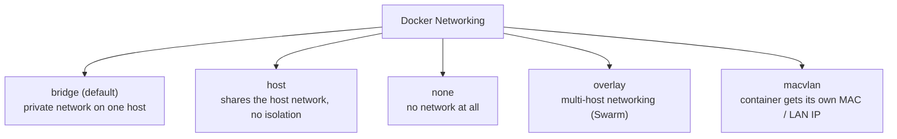
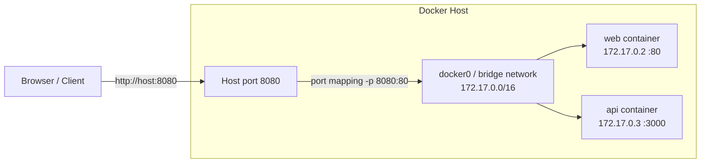
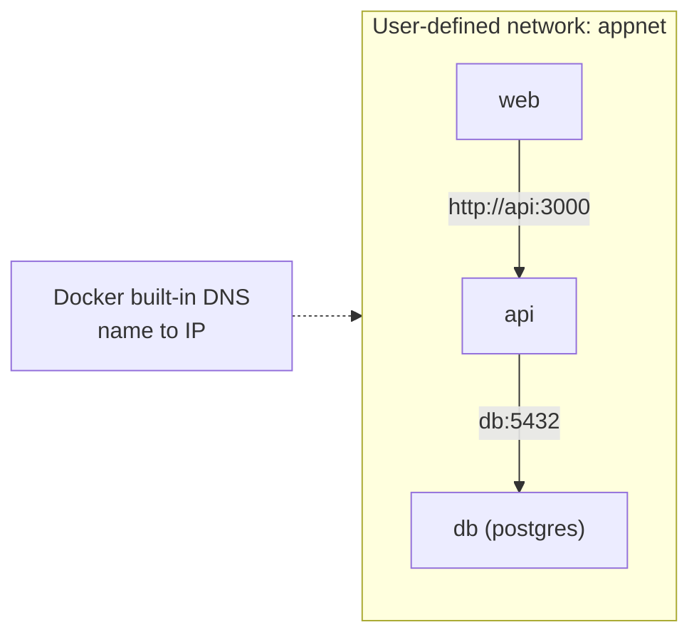
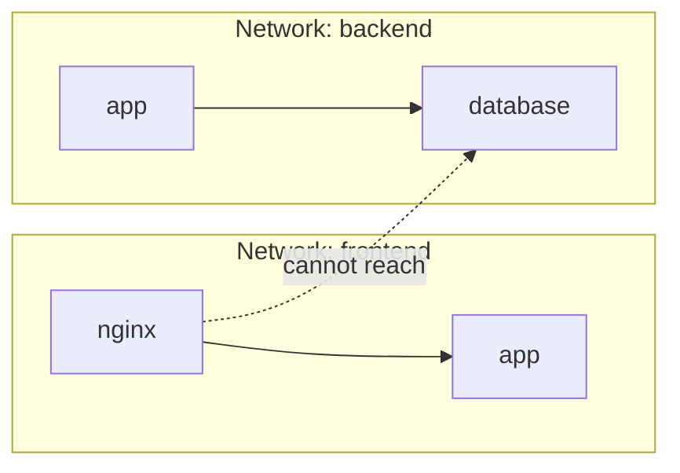

## 6. Docker Networking
 
### 6.1 Network Drivers
 

 
| Driver | Description | Use case |
|---|---|---|
| `bridge` | Default. Containers get private IPs behind the host | Most single-host apps |
| `host` | Container uses the host's network directly | Max network performance |
| `none` | Fully isolated, no networking | Security / batch jobs |
| `overlay` | Spans multiple Docker hosts | Swarm / clusters |
| `macvlan` | Container appears as a physical device on the LAN | Legacy apps needing a LAN IP |
 
### 6.2 Bridge Network and Port Mapping
 

 
```
-p 8080:80
     |    |
     |    +-- port INSIDE the container
     +------- port on the HOST machine
```
 
### 6.3 Container-to-Container Communication
 
On the **default** bridge you must use IP addresses. On a **user-defined bridge**, containers reach each other **by name** (built-in DNS).
 

 
```bash
docker network create appnet
docker run -d --name db  --network appnet -e POSTGRES_PASSWORD=secret postgres:16
docker run -d --name api --network appnet -p 3000:3000 myapi
# inside "api", connect to host "db" on port 5432
```
 
### 6.4 Network Commands
 
| Command | What it does |
|---|---|
| `docker network ls` | List networks |
| `docker network create mynet` | Create a network |
| `docker network inspect mynet` | Show details (connected containers, IPs) |
| `docker network connect mynet web` | Attach a running container |
| `docker network disconnect mynet web` | Detach a container |
| `docker network rm mynet` | Remove a network |
| `docker port web` | Show port mappings of a container |
 
### 6.5 Isolation Between Networks
 

 
Put the database only on the `backend` network, so the public-facing container cannot reach it directly.
 