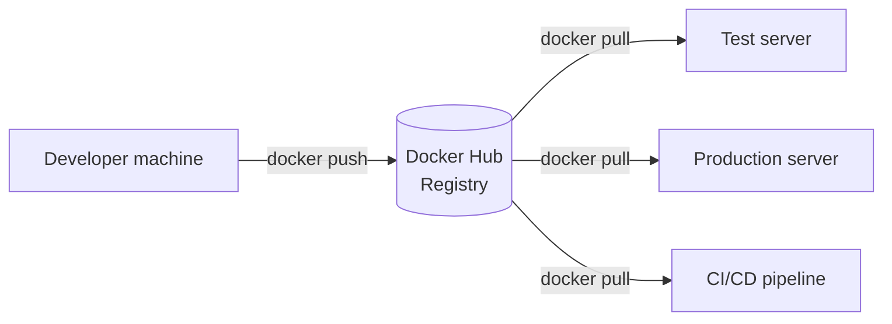
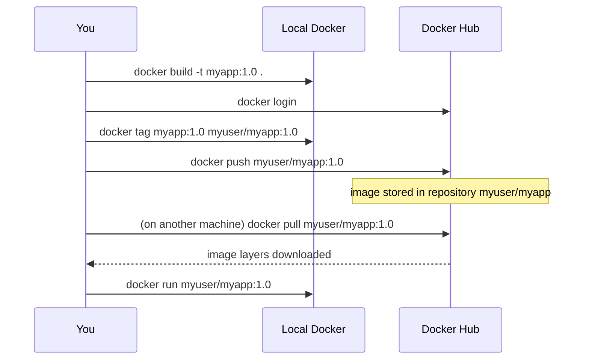

## 7. Docker Hub
 
### 7.1 What is Docker Hub?
 
**Docker Hub** (<https://hub.docker.com>) is the default **public registry** for Docker images. Think of it as "GitHub for images".
 

 
### 7.2 What It Provides
 
| Item | Meaning |
|---|---|
| **Official Images** | Maintained and verified (nginx, postgres, redis, node, python, ubuntu, ...) |
| **Verified Publisher** | Images from trusted companies |
| **Repositories** | Your own public (and private, depending on plan) image storage |
| **Tags** | Versions of an image (`nginx:1.27`, `nginx:alpine`, `nginx:latest`) |
| **Extras** | Automated builds, webhooks, vulnerability scanning (depends on plan) |
 
### 7.3 Image Naming
 
```
[registry/][username/]repository[:tag]
 
nginx                    -> official image, tag "latest"
nginx:1.27-alpine        -> specific version
myuser/myapp:2.0         -> your repo on Docker Hub
ghcr.io/org/app:1.0      -> a different registry (GitHub)
```
 
> Avoid `latest` in production. Pin a specific version tag.
 
### 7.4 Push and Pull Workflow
 

 
```bash
docker login
docker search redis
docker pull redis:7
docker tag myapp:1.0 myuser/myapp:1.0
docker push myuser/myapp:1.0
docker logout
```
 
### 7.5 Other Registries
 
| Registry | Provider |
|---|---|
| Docker Hub | Docker |
| GHCR (`ghcr.io`) | GitHub |
| ECR | AWS |
| ACR | Azure |
| Artifact Registry | Google Cloud |
| `registry:2` | Self-hosted (you run your own) |
 
> Docker Hub applies **pull rate limits** for anonymous and free accounts. Logging in raises the limit.
 