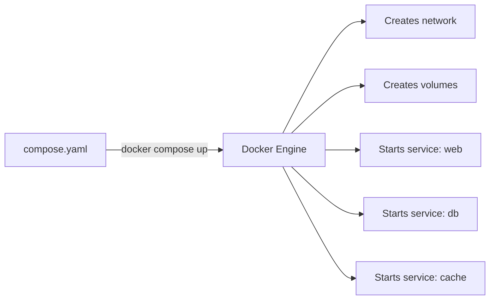
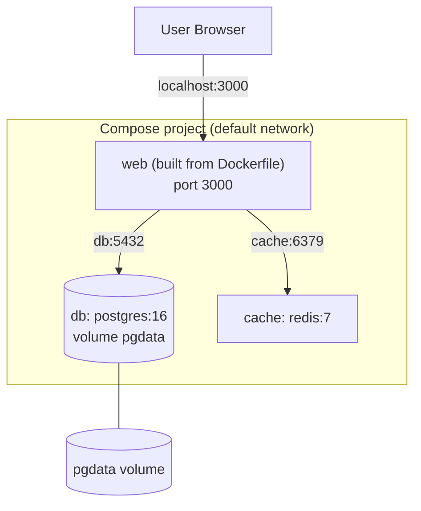
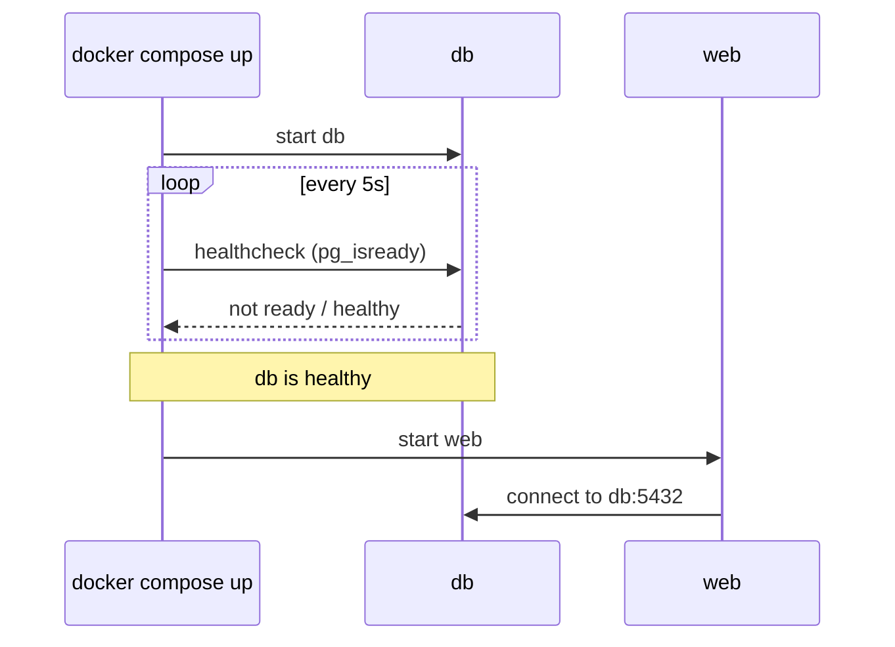

## 8. Docker Compose
 
### 8.1 What is Docker Compose?
 
**Docker Compose** defines and runs **multi-container applications** from one YAML file (`compose.yaml` or `docker-compose.yml`).
 
Instead of many long `docker run` commands, write one file and start everything with **one command**.
 
> Modern Docker uses `docker compose` (with a space). The old `docker-compose` (with a hyphen) is the legacy standalone tool.
 

 
### 8.2 Example Stack: Web + Database + Cache
 

 
`compose.yaml`
 
```yaml
services:
  web:
    build: .                      # build from local Dockerfile
    ports:
      - "3000:3000"
    environment:
      DB_HOST: db
      DB_USER: appuser
      DB_PASSWORD: secret
      CACHE_HOST: cache
    depends_on:
      db:
        condition: service_healthy
      cache:
        condition: service_started
    restart: unless-stopped
 
  db:
    image: postgres:16
    environment:
      POSTGRES_USER: appuser
      POSTGRES_PASSWORD: secret
      POSTGRES_DB: appdb
    volumes:
      - pgdata:/var/lib/postgresql/data
    healthcheck:
      test: ["CMD-SHELL", "pg_isready -U appuser -d appdb"]
      interval: 5s
      timeout: 3s
      retries: 5
    restart: unless-stopped
 
  cache:
    image: redis:7
    restart: unless-stopped
 
volumes:
  pgdata:
```
 
### 8.3 File Structure Explained
 
| Key | Meaning |
|---|---|
| `services` | Each container in your app |
| `image` | Use an existing image |
| `build` | Build from a Dockerfile |
| `ports` | Port mapping (`host:container`) |
| `environment` / `env_file` | Environment variables |
| `volumes` | Persistent storage or bind mounts |
| `depends_on` | Start order (with `condition` to wait for health) |
| `networks` | Custom networks (a default one is created automatically) |
| `restart` | Restart policy |
| `command` | Override the default command |
| `healthcheck` | Test whether a service is healthy |
 
### 8.4 Startup Order with Healthcheck
 

 
### 8.5 Compose Commands
 
| Command | What it does |
|---|---|
| `docker compose up` | Create and start all services |
| `docker compose up -d` | Start in background |
| `docker compose up --build` | Rebuild images, then start |
| `docker compose down` | Stop and remove containers and networks |
| `docker compose down -v` | Also remove volumes (**deletes data**) |
| `docker compose ps` | List containers of the project |
| `docker compose logs -f` | Follow logs of all services |
| `docker compose logs -f web` | Follow logs of one service |
| `docker compose exec web sh` | Open a shell in a service |
| `docker compose stop` / `start` / `restart` | Control services |
| `docker compose build` | Build images only |
| `docker compose pull` | Pull latest images |
| `docker compose config` | Validate and show the final config |
 
### 8.6 Using a `.env` File
 
`.env`
 
```
POSTGRES_PASSWORD=secret
APP_PORT=3000
```
 
`compose.yaml`
 
```yaml
services:
  web:
    build: .
    ports:
      - "${APP_PORT}:3000"
  db:
    image: postgres:16
    environment:
      POSTGRES_PASSWORD: ${POSTGRES_PASSWORD}
```
 
> Never commit real secrets to Git. Add `.env` to `.gitignore`.
 