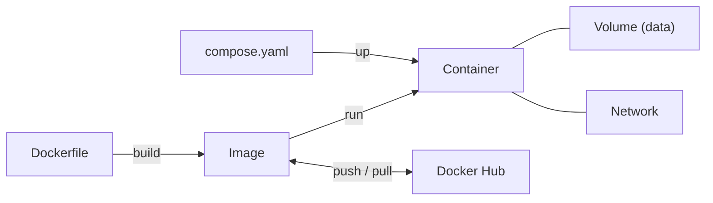

## 9. Best Practices and Cheat Sheet
 
### 9.1 Best Practices
 
1. Use **small base images** (`alpine`, `slim`).
2. **Pin versions** (`node:20-alpine`, not `node:latest`).
3. **One main process per container**; connect several with Compose.
4. **Do not run as root**: use `USER`.
5. Use **`.dockerignore`** to keep builds small.
6. Order Dockerfile steps from **least to most frequently changed**.
7. Use **multi-stage builds** to keep build tools out of the final image.
8. Store data in **volumes**; containers are disposable.
9. **Never hard-code secrets** in images.
10. **Scan images** for vulnerabilities (`docker scout`, Trivy).
11. Set **resource limits** on servers (`--memory`, `--cpus`).
12. Clean up regularly with `docker system prune`.
### 9.2 Troubleshooting
 
| Problem | Fix |
|---|---|
| `permission denied` on `/var/run/docker.sock` | Add your user to the `docker` group or use `sudo` |
| `port is already allocated` | Use another host port (`-p 8081:80`) or stop the other service |
| Container exits immediately | Run `docker logs <name>` |
| Containers cannot reach each other | Use the same user-defined network and the container name |
| Platform mismatch warning | Use `--platform` or a multi-arch image |
| Disk full | `docker system df` then `docker system prune` |
 
### 9.3 Quick Cheat Sheet
 
```bash
# Run
docker run -d --name web -p 8080:80 nginx
 
# Inspect
docker ps -a
docker logs -f web
docker exec -it web sh
 
# Stop and remove
docker stop web && docker rm web
 
# Build and push
docker build -t myuser/app:1.0 .
docker push myuser/app:1.0
 
# Compose
docker compose up -d
docker compose logs -f
docker compose down
```
 
### 9.4 Concept Summary
 

 
| Concept | One-line meaning |
|---|---|
| **Kernel** | The OS core that Docker containers share |
| **Namespaces / cgroups** | Linux features that isolate and limit containers |
| **Docker Engine** | Software that builds and runs containers |
| **Image** | Read-only template (blueprint) |
| **Container** | Running instance of an image |
| **Dockerfile** | Recipe to build an image |
| **Volume** | Persistent storage outside the container's life |
| **Network** | Virtual network for container communication |
| **Docker Hub** | Public registry to share images |
| **Compose** | Run multi-container apps with one YAML file |
 
---
 
*End of document.*
 